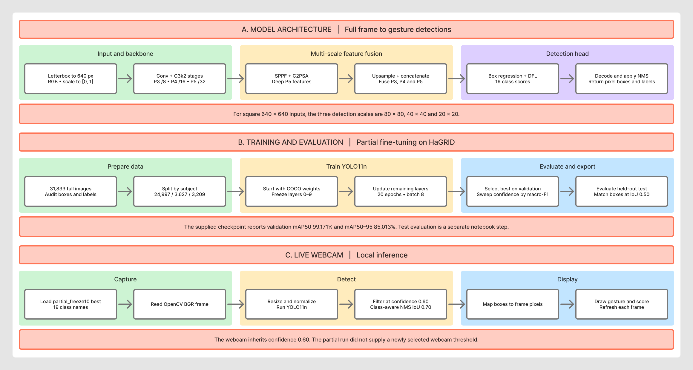

# Hand Gesture Detection — YOLO11n Partial Fine-tuning

Standalone hand gesture detection for COS30082 Applied Machine Learning. A COCO-pretrained YOLO11n was partially fine-tuned (backbone layers 0–9 frozen) on the compact HaGRID dataset to detect **18 gestures and `no_gesture`**. The model returns a label, bounding box, and confidence for each detected hand.

## Architecture and workflow

The diagram covers the YOLO11n architecture, training and evaluation workflow, and local webcam inference.

[](assets/hand_gesture_architecture.png)

Click the image to view it at full resolution, or [open the editable FigJam board](https://www.figma.com/board/OU8PwRD93dNFnG5lxBypHH?node-id=3-123).

## Files

- `hand_gesture_yolo11n_partial_freeze10_best.pt`: selected partial-training checkpoint, used by default for inference.
- `hand_gesture_yolo11n_partial_freeze10_last.pt`: final-epoch partial-training checkpoint.
- `hand_gesture_partial_freeze10_results/`: original run configuration, training logs, validation curves, and sample images from the supplied ZIP.
- `webcam_gesture.py`: local Windows webcam demo.
- `hand_gesture_yolo11n_colab.ipynb`: data preparation, partial fine-tuning, evaluation, inference, and export in Google Colab.

## Run the webcam demo

Tested on **Windows with Python 3.14**, PyTorch 2.11.0 (CPU), and Ultralytics 8.4.193. Open a terminal in this folder; from the repository root, run `cd models/hand_gesture_detection` first.

```powershell
python -m venv .venv
.\.venv\Scripts\python.exe -m pip install torch==2.11.0 torchvision==0.26.0 --index-url https://download.pytorch.org/whl/cpu
.\.venv\Scripts\python.exe -m pip install ultralytics==8.4.193
.\.venv\Scripts\python.exe webcam_gesture.py
```

Keep `hand_gesture_yolo11n_partial_freeze10_best.pt` beside the script. Press **Q** or **Escape**, or close the window, to stop. Frames are processed locally and are not recorded. No dataset download or training is needed for this demo.

For a faster preview, use a smaller inference size:

```powershell
.\.venv\Scripts\python.exe webcam_gesture.py --imgsz 320
```

Smaller hands may be harder to detect at 320. Default inference size is 640, confidence is 0.60, and NMS IoU is 0.70. Select a confidence threshold on validation using the notebook's operating-point evaluation. If the camera is unavailable, close other camera apps, check Windows camera permissions, or try `--camera 1`.

Check model loading without opening the webcam:

```powershell
.\.venv\Scripts\python.exe webcam_gesture.py --check
```

## Colab notebook

[Open in Google Colab](https://colab.research.google.com/github/vuongngoo/COS30082---Applied-Machine-Learning/blob/main/models/hand_gesture_detection/hand_gesture_yolo11n_colab.ipynb)

Select a GPU runtime and run the cells in order. Google Drive stores training checkpoints and exported results.

- `RUN_MODE = 'smoke'`: short pipeline check using a small subset and 2 epochs. This is the fresh-runtime default.
- `RUN_MODE = 'full'`: train on the whole training split for up to 20 epochs with `FREEZE = 10`, then evaluate and export. The run name is `partial_freeze10`.
- `RUN_MODE = 'evaluate'`: load the checkpoint specified by `WEIGHTS` and evaluate without training.

The notebook defaults to partial fine-tuning with a smoke run for a fresh runtime. Set `RUN_MODE = 'evaluate'` and point `WEIGHTS` to the supplied partial best checkpoint to obtain its test metrics and select its confidence on validation.

Use `RESUME_FULL = True` only with a still-resumable checkpoint from an interrupted run. Both supplied partial checkpoints are stripped exports (no optimizer state, epoch -1), so they cannot exactly resume an interrupted run. They can be used for inference or as initial weights for a new fine-tuning run.

## Dataset and results

Dataset: [cj-mills/hagrid-sample-30k-384p](https://huggingface.co/datasets/cj-mills/hagrid-sample-30k-384p), derived from [HaGRID](https://github.com/hukenovs/hagrid). The compact dataset card lists **CC BY-SA 4.0**. Dataset images retained in notebook outputs are attributed to these sources. The dataset archive is downloaded by the notebook and is not stored in this folder.

The notebook uses subject-disjoint partitions of the **31,833 images**: **24,997 train / 3,627 validation / 3,209 test**. The supplied `partial_freeze10` run completed 20 epochs with batch 8, image size 640, and `freeze=10`. Its run configuration and complete 20-epoch log are included in `hand_gesture_partial_freeze10_results/`.

The selected checkpoint reports the following **validation** metrics:

| Validation metric | Partial fine-tuning |
| --- | ---: |
| Precision | 97.888% |
| Recall | 97.930% |
| mAP50 | 99.171% |
| mAP50–95 | 85.013% |

These values come from the supplied best checkpoint's `train_metrics` and agree with epoch 20 in `results.csv`. Use the notebook's evaluation mode to measure held-out test performance and select the confidence threshold on validation.

Supported labels:

```text
call, dislike, fist, four, like, mute, no_gesture, ok, one, palm,
peace, peace_inverted, rock, stop, stop_inverted, three, three2,
two_up, two_up_inverted
```

## Limitations

- Back-of-hand views of `three` / `four` may be confused with `peace_inverted` in webcam use.
- Small, occluded, or poorly lit hands can be missed or confused.
- `no_gesture` means a visible natural hand. It is not an empty frame; the fixed benchmark does not include a confirmed no-hand test set.
- Each frame is processed independently. Motion gestures, person identification, and attendance actions are not implemented.
- CPU speed depends on the computer and inference size. Benchmark scores do not guarantee the same performance in a different camera environment.

Model SHA-256:

```text
a1d0eef782ef694435ff4207f5691ac5dd484ebb798ceb593094afc66f6b17a9
```
